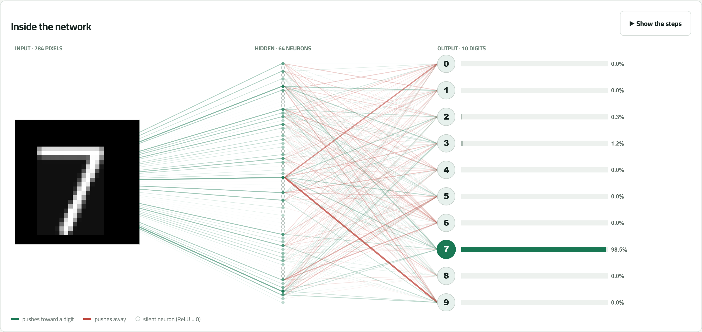

# How AI Learns to See

An interactive, fully offline web page that shows a small neural network learning to read handwritten digits (MNIST) right in your browser. You can see the data, watch it train, and look inside the network while it guesses your own handwriting.



> **بالعربي:** موقع تفاعلي يوضّح شلون الشبكة العصبية تتعلّم تقرا الأرقام المكتوبة بخط اليد. التدريب كله يصير داخل المتصفح وما يحتاج إنترنت. طريقة التشغيل تحت.

## Features

| Screen | What you see |
|---|---|
| **01 · The data** | Real MNIST digits. Click any digit to see its 28 × 28 grid of brightness values, then pick how many images to train on (10 to 55,000). |
| **02 · Before learning** | Draw a digit for a network that has random weights, so its guess means nothing yet. |
| **03 · Training** | Live training with epoch progress, an accuracy and loss curve, 20 unseen test images, and an animated diagram of the network. Hover a neuron to see what it does. |
| **04 · Try it** | Draw your own digit and follow it through the trained network: 784 pixels → 64 hidden neurons → 10 digit scores. |

- Runs entirely in the browser with [TensorFlow.js](https://www.tensorflow.org/js), so there is no backend and no install.
- Works offline. Every library, font and the dataset ship with the repo.
- The trained model is saved in the browser (IndexedDB), so it is still there after a reload. **Start over** clears it.
- Keyboard: `←` / `→` switch screens, `Space` pauses or resumes training, `C` clears the drawing.

## Quick start

There is nothing to install. Pick one of these:

**1. Just open it.** Double-click `index.html`. It works directly from disk.

**2. Run a local server (recommended).**

Windows: double-click `run.bat`, or run:

```bash
run.bat
```

macOS / Linux:

```bash
./run.sh
```

Each script starts `python -m http.server` on <http://localhost:8000> and opens the page. It needs [Python 3](https://www.python.org/downloads/). Any other static server works too, for example:

```bash
npx serve .
```

**3. Put it online with GitHub Pages.** Push the repo, then go to **Settings → Pages → Build and deployment**, choose **Deploy from a branch**, and select `main` / `(root)`. The site will be live at `https://<your-username>.github.io/<repo-name>/`.

## Browser support

Use a recent Chrome, Edge, Firefox or Safari (Safari 16.4 or newer). The page uses WebGL for fast training and falls back to the CPU when WebGL isn't available.

## How it works

```
input 784 (28×28 pixels, 0–1)
  → Dense 64, ReLU
  → Dense 10, softmax
optimizer: Adam (lr 0.001) · loss: categorical cross-entropy · batch 64
```

- **Split:** the first 55,000 MNIST training images form the training pool, the last 5,000 are validation images (checked after every epoch on 1,000 of them), and the standard 10,000 test images are used once, at the end, for the final accuracy.
- **Your drawing** is cropped, scaled to 20 × 20, centered by its center of mass on a 28 × 28 grid, and normalized to 0–1, the same way MNIST digits were prepared.
- With 10,000 images and 10 epochs the network usually reaches about **94–95 %** on the test set. With all 55,000 images it reaches about 97 %.

## Project structure

```
index.html              Page layout (4 screens)
css/style.css           Styles
js/
  app.js                Screens, UI state, training flow
  model.js              DigitModel: the TensorFlow.js network (train / evaluate / inspect / save)
  network.js            NetworkView: the interactive network diagram (canvas)
  draw.js               Drawing canvas and MNIST-style preprocessing
  data.js               Loads and checks the MNIST data
data/mnist.js           MNIST (gzip + base64, about 15 MB)
lib/                    TensorFlow.js and Chart.js (vendored, for offline use)
fonts/                  Cairo font + its license
tools/make-mnist-bundle.py  Rebuilds data/mnist.js from the original IDX files
run.bat / run.sh        Local server launchers
```

### Rebuilding the dataset (optional)

`data/mnist.js` is already included. To rebuild it, download the four original MNIST IDX files (`train-images-idx3-ubyte`, `train-labels-idx1-ubyte`, `t10k-images-idx3-ubyte`, `t10k-labels-idx1-ubyte`, unzipped) into a folder and run:

```bash
python tools/make-mnist-bundle.py path/to/folder
```

## Credits & third-party licenses

- **MNIST** database: Yann LeCun, Corinna Cortes and Christopher J. C. Burges.
- **TensorFlow.js** (`lib/tf.min.js`): © Google LLC, Apache License 2.0.
- **Chart.js v4.6.1** (`lib/chart.umd.min.js`): © Chart.js Contributors, MIT License.
- **Cairo** font (`fonts/`): SIL Open Font License 1.1, see `fonts/OFL-Cairo.txt`.
